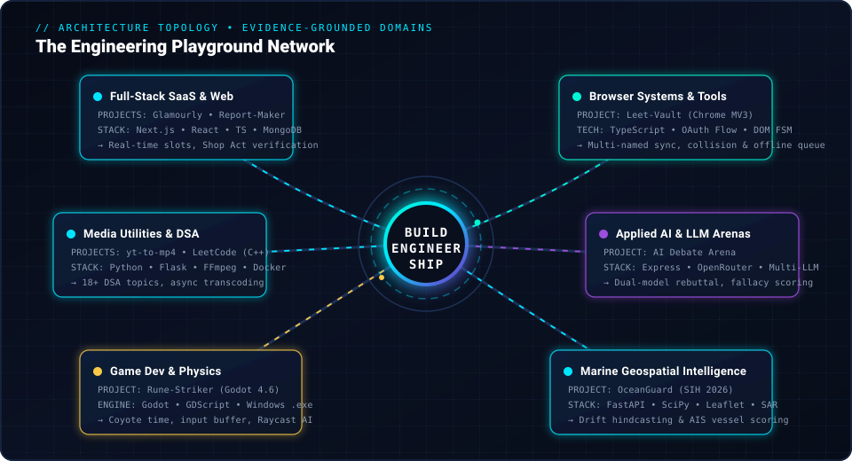
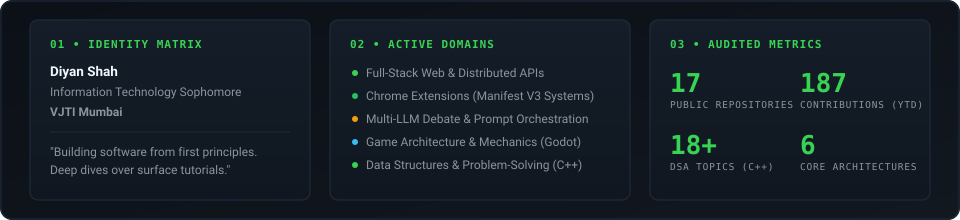
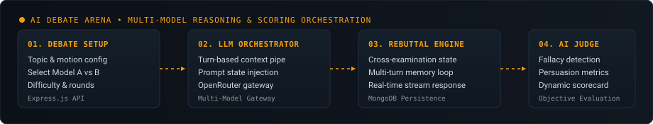
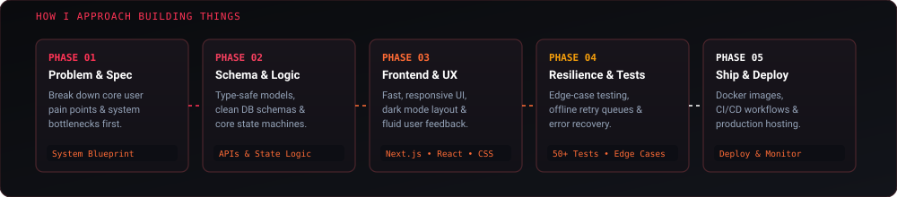

<!-- ================================================================= -->
<!--                DIYAN SHAH — THE ENGINEERING PLAYGROUND            -->
<!-- ================================================================= -->

<div align="center">
  <a href="https://github.com/Diyan4444">
    
  </a>
</div>

<br>

<div align="center">

[](https://github.com/Diyan4444)
[](https://www.linkedin.com/in/diyan-shah-14b4993a9/)
[](https://leetcode.com/u/Diyan4444/)
[](mailto:diyanshah2301@gmail.com)

</div>

<br>

---

## ⚡ Executive Summary

I am **Diyan Shah**, a B.Tech Information Technology student at **VJTI Mumbai (Veermata Jijabai Technological Institute)**. 

I engineer software by building real systems from first principles. Rather than relying on passive tutorials or superficial templates, I explore and ship across diverse technical domains: from high-concurrency full-stack platforms and production Chrome extensions (Manifest V3) to multi-model LLM debate engines, satellite radar geospatial pipelines, and Godot 2D game architecture.

```text
  [ Core Stack ]   TypeScript • C++ • Python • Next.js • Node.js • Godot • Docker • MongoDB
  [ Education  ]   B.Tech Information Technology — VJTI Mumbai
  [ Focus Area ]   Full-Stack Systems • Browser Architecture • Applied AI • Algorithmic Problem Solving
  [ Philosophy ]   "Learn by shipping real software. Architect resilient, verifiable systems."
```

> 💡 **Interactive Web Portfolio**: For an interactive version with true viewport-triggered animations and node inspection, explore [`preview/index.html`](file:///c:/Users/Diyan/Desktop/Github%20Readme/preview/index.html).

---

## 🌐 The Engineering Playground Network

The architectural map below illustrates how my core engineering foundation connects each technical domain and repository.

<div align="center">
  
</div>

<br>

### 📡 Network Node Breakdown

1. **Full-Stack SaaS & Web Platforms**  
   * **[Glamourly](https://github.com/Diyan4444/Glamourly)**: Curated salon discovery and real-time appointment booking engine handcrafted for Mumbai with Next.js, React, TypeScript, and MongoDB. Features zero forced prepayments and Shop Act verification.
   * **[Report-Maker](https://github.com/Diyan4444/Report-Maker)**: Internal corporate intelligence platform tracking company profiles, relationship graphs, and automated PDF/Excel reports with PostgreSQL (Prisma), Redis, and Docker.
   * **[RentWheels](https://github.com/Diyan4444/RentWheels)**: Responsive vehicle rental platform deployed live at [wheel-rent.netlify.app](https://wheel-rent.netlify.app/).

2. **Browser Systems & Tooling**  
   * **[Leet-Vault](https://github.com/Diyan4444/Leet-Vault)**: Production-ready Chrome Extension (Manifest V3) engineered with a strict DOM snapshot state machine, serverless OAuth broker, 18+ language mappings, collision resolution, and offline alarm retry queues backed by 50+ unit/integration tests.

3. **Applied AI & LLM Sparring**  
   * **[AI Debate Arena](https://github.com/Diyan4444/AI-Debater)**: Turn-based debate platform comparing how different language models argue and respond to topics using Express.js, MongoDB, and OpenRouter API, featuring real-time argument streaming and automated fallacy judging.

4. **Geospatial & Marine Intelligence**  
   * **[OceanGuard AI](https://github.com/Diyan4444/OceanGuard)**: Smart India Hackathon 2026 project combining SAR satellite radar imagery segmentation, ocean current hydrodynamic drift hindcasting, and AIS vessel cross-matching with FastAPI, SciPy, React 19, and Leaflet.

5. **Interactive Systems & Game Development**  
   * **[Rune-Striker](https://github.com/Diyan4444/Rune-Striker)**: Handcrafted 2D retro action-platformer in Godot 4.6 (GDScript) with Coyote Time jump forgiveness, input buffering, slime raycast patrol AI, decoupled coin event bus, and a standalone Windows `.exe` build.

6. **Media Utilities & High-Throughput DSA**  
   * **[YouTube Converter (yt-to-mp4)](https://github.com/Diyan4444/yt-to-mp4)**: Media extraction utility built with Flask, yt-dlp, FFmpeg, and Docker with concurrency throttling and temp-file auto-cleanup.
   * **[LeetCode Practice (C++)](https://github.com/Diyan4444/LeetCode)**: Algorithmic solutions categorized across 18+ topics including Dynamic Programming, Graphs, Heaps, Trees, and Trie structures in C++.

---

## 🎛️ Developer Console HUD

<div align="center">
  
</div>

---

## 🚀 Project Constellation Showcase

A detailed look at my primary verified projects, their technical architecture, and the engineering problems they solve.

<br>

### 1. 💇 Glamourly — Mumbai Salon Discovery & Direct Booking Platform
> **Repository:** [`Diyan4444/Glamourly`](https://github.com/Diyan4444/Glamourly) • **Status:** Active Full-Stack Application

<div align="center">
  
</div>

* **Problem Solved:** Most salon booking portals enforce upfront online prepayments, lack verified licenses, or obscure true treatment pricing.
* **Architecture & Capabilities:**
  * **Geospatial Discovery:** Filter verified beauty studios across Mumbai (Bandra, Juhu, Worli, Colaba, Andheri) by real distance, rating, and explicit treatment rate cards.
  * **Zero Prepayments:** Direct offline reservations where customers pay strictly after service completion.
  * **Provider Control Dashboard:** Salon owners configure branch operating hours, manage stylist shift allocations, declare break periods, and verify statutory Shop Act and trade licenses.
  * **AI Concierge:** Embedded smart salon assistant delivering personalized treatment recommendations based on user preferences.
* **Stack:** `Next.js` • `React` • `TypeScript` • `Tailwind CSS` • `Node.js` • `MongoDB Atlas`

---

### 2. ⚡ Leet-Vault — Chrome Extension (Manifest V3) Solution Sync
> **Repository:** [`Diyan4444/Leet-Vault`](https://github.com/Diyan4444/Leet-Vault) • **Status:** Production-Ready Chrome Extension • **Test Suite:** 50+ Unit/Integration Tests

<div align="center">
  
</div>

* **Problem Solved:** Existing LeetCode sync extensions blindly overwrite previous solutions, leak personal access tokens (PATs), trigger false-positive commits on page navigation, or crash on network drops.
* **Architecture & Capabilities:**
  * **User-Named Multi-Solution Architecture:** Enables unlimited named solutions per problem (`0912-sort-an-array/heap-sort.cpp`, `merge-sort.cpp`) with deterministic `solution-N.cpp` fallback.
  * **Submit-Only Snapshot State Machine:** Hooks exclusively into user **Submit** actions, capturing an immediate code snapshot to eliminate SPA false positives.
  * **Production OAuth Broker:** Implements `chrome.identity.launchWebAuthFlow` with zero client secrets embedded in the extension bundle and authoritative write-permission verification.
  * **Collision & Duplicate Protection:** Generates SHA code fingerprints to prevent duplicate commits and offers explicit overwrite vs. versioning prompts.
  * **Offline Alarm Queue:** Catches GitHub API rate limits and network drops in a persistent queue with automatic alarm-based retry cycles.
* **Stack:** `TypeScript` • `Chrome Extensions API (MV3)` • `Chrome Identity API` • `GitHub REST API` • `Vite` • `Vitest`

---

### 3. 🤖 AI Debate Arena — Multi-Model Argumentation & Scoring Engine
> **Repository:** [`Diyan4444/AI-Debater`](https://github.com/Diyan4444/AI-Debater) • **Status:** Active Development & Exploration

<div align="center">
  
</div>

* **Problem Solved:** Evaluating and comparing how different LLMs reason, handle rebuttals, and maintain logical integrity when debating contentious motions.
* **Architecture & Capabilities:**
  * **Turn-Based Debate Orchestration:** Configures topics, stances, difficulty parameters, and round counts between two distinct language models.
  * **OpenRouter Gateway Integration:** Unified API interface querying competing LLMs under structured system prompts.
  * **Dynamic Scoring & Fact-Checking:** Automated scoring layer evaluating counterarguments for logical consistency, fallacies, persuasiveness, and clarity.
* **Stack:** `Node.js` • `Express.js API` • `MongoDB` • `OpenRouter API` • `JavaScript (ES6+)`

---

### 4. 🛰️ OceanGuard AI — SAR Satellite Oil Spill & AIS Vessel Attribution
> **Repository:** [`Diyan4444/OceanGuard`](https://github.com/Diyan4444/OceanGuard) • **Status:** Smart India Hackathon 2026 (Problem SIH26143)

<div align="center">
  
</div>

* **Problem Solved:** Identifying illegal marine oil dumping from space, accounting for ocean surface drift, and legally holding responsible maritime vessels accountable.
* **Architecture & Capabilities:**
  * **SAR Satellite Segmentation:** Extracts dark slicks from Synthetic Aperture Radar (SAR) imagery via computer vision segmentation models.
  * **Hydrodynamic Drift Hindcasting:** Simulates ocean currents and wind vectors backward in time to calculate the exact spill origin coordinates.
  * **AIS Telemetry Cross-Referencing:** Cross-references global AIS vessel tracks with the calculated origin coordinates and timestamps.
  * **Suspect Anomaly Scoring:** Evaluates candidate ships on proximity, speed anomalies, and deliberate AIS transmitter blackouts.
* **Stack:** `Python` • `FastAPI` • `NumPy` • `SciPy` • `React 19` • `Vite` • `Leaflet` • `CartoDB Dark Tiles` • `SQLite`

---

### 5. ⚔️ Rune-Striker — 2D Retro Action-Platformer
> **Repository:** [`Diyan4444/Rune-Striker`](https://github.com/Diyan4444/Rune-Striker) • **Status:** Standalone Windows Release Available

<div align="center">
  
</div>

* **Problem Solved:** Designing responsive, forgiving 2D kinematic platforming mechanics and autonomous enemy patrol AI without bloated engine overhead.
* **Architecture & Capabilities:**
  * **Precision Movement & Coyote Time:** Implements jump forgiveness (Coyote Time) and input buffering to prevent missed inputs at platform ledges.
  * **Character Kinematic FSM:** Smooth state transitions between `IDLE`, `RUN`, and `JUMP` with direction facing logic.
  * **Raycast Enemy Patrols:** Slimes patrol platforms autonomously, using horizontal and downward ledge raycasts to detect barriers and turnaround points.
  * **Decoupled Game Manager Event Bus:** Coin collection and HUD counter updates communicated via Godot signals.
  * **Release Packaging:** Exported as an optimized, standalone Windows `.exe` binary.
* **Stack:** `Godot 4.6` • `GDScript` • `2D Vector Physics` • `Raycast Collision AI` • `Windows Executable`

---

### 6. 🎬 YouTube Converter (`yt-to-mp4`) — Media Transcoding Service
> **Repository:** [`Diyan4444/yt-to-mp4`](https://github.com/Diyan4444/yt-to-mp4) • **Status:** Containerized Microservice

<div align="center">
  
</div>

* **Problem Solved:** Lightweight, containerized web service for high-quality audio and video transcoding without third-party ad injection.
* **Architecture & Capabilities:**
  * **Format & Quality Probing:** Fetches available container formats, resolutions, and audio bitrates dynamically.
  * **Worker Concurrency Throttling:** Strict queue management (`MAX_CONCURRENT_DOWNLOADS=5`) prevents CPU exhaustion during FFmpeg transcode jobs.
  * **Real-Time Progress Streaming:** API polling for download percentages, byte rates, and estimated completion times.
  * **Automated Ephemeral Cleanup:** Temporary scratch files automatically purged post-transcoding to maintain disk health.
* **Stack:** `Python` • `Flask` • `yt-dlp` • `FFmpeg` • `Docker` • `Render Config`

---

## 🛠️ Inside the Build: Engineering Methodology

How I take an engineering idea from specification to a hardened, deployed product:

<div align="center">
  
</div>

<br>

| Phase | Methodology & Actions | Verifiable Evidence |
| :--- | :--- | :--- |
| **01. Problem & Architecture** | Dissect user pain points, define boundary conditions, and draft system contracts before writing code. | Leet-Vault submission state machine specification; Glamourly Shop Act flow. |
| **02. Schema & Engine Design** | Design type-safe data models, relational/document schemas, and state machines with zero data corruption. | MongoDB Atlas clusters, PostgreSQL Prisma schemas, Godot kinematic FSMs. |
| **03. UI & Interactive Experience** | Develop responsive, dark-mode native interfaces with real-time feedback and clean typography. | React 19, Next.js App Router, Tailwind CSS, Leaflet geospatial maps. |
| **04. Testing & Edge-Case Resilience** | Implement deterministic error queues, duplicate code detection, and exhaustive unit suites. | 50+ unit and integration tests in Leet-Vault; Coyote jump buffering in Rune-Striker. |
| **05. Containerization & Deployment** | Package binaries, Docker containers, and CI/CD pipelines for production stability. | Dockerfiles, Render configurations, Netlify live deployments, Standalone `.exe`. |

---

## 💻 Demonstrated Skills & Technologies

Technologies categorized strictly by demonstrated repository source code:

<table>
  <tr>
    <td width="33%" valign="top">
      <h4>⚡ Languages</h4>
      <ul>
        <li><b>TypeScript</b> (Glamourly, Leet-Vault, Report-Maker)</li>
        <li><b>JavaScript [ES6+]</b> (AI-Debater, RentWheels)</li>
        <li><b>C++ [STL / DSA]</b> (LeetCode, Shorties, OSTLAB)</li>
        <li><b>Python</b> (OceanGuard, yt-to-mp4)</li>
        <li><b>GDScript</b> (Rune-Striker Engine)</li>
        <li><b>SQL / PLpgSQL</b> (PostgreSQL / Prisma)</li>
        <li><b>HTML5 & CSS3</b> (Modern responsive semantic layouts)</li>
      </ul>
    </td>
    <td width="33%" valign="top">
      <h4>🌐 Frontend & UI</h4>
      <ul>
        <li><b>Next.js (App Router)</b></li>
        <li><b>React & React 19</b></li>
        <li><b>Tailwind CSS</b></li>
        <li><b>Vite & Bundlers</b></li>
        <li><b>Leaflet.js & CartoDB Maps</b></li>
        <li><b>Recharts Data Visualization</b></li>
        <li><b>Responsive / Dark Mode Systems</b></li>
      </ul>
    </td>
    <td width="33%" valign="top">
      <h4>⚙️ Backend & Systems</h4>
      <ul>
        <li><b>Node.js & Express.js</b></li>
        <li><b>FastAPI (Python)</b></li>
        <li><b>Flask REST APIs</b></li>
        <li><b>Chrome Extension MV3 Architecture</b></li>
        <li><b>Chrome Identity API & OAuth Brokers</b></li>
        <li><b>OpenRouter Multi-LLM Gateway</b></li>
        <li><b>FFmpeg & yt-dlp Transcoding</b></li>
      </ul>
    </td>
  </tr>
  <tr>
    <td width="33%" valign="top">
      <h4>🗄️ Databases & Storage</h4>
      <ul>
        <li><b>MongoDB Atlas</b> (Document Store)</li>
        <li><b>PostgreSQL & Prisma ORM</b></li>
        <li><b>Redis</b> (Cache & Sessions)</li>
        <li><b>SQLite</b> (Zero-config local DB)</li>
      </ul>
    </td>
    <td width="33%" valign="top">
      <h4>🛠️ DevOps & Environments</h4>
      <ul>
        <li><b>Docker & Containerization</b></li>
        <li><b>Git & GitHub Actions</b></li>
        <li><b>Linux Command Line & Bash</b></li>
        <li><b>VS Code & Android Studio</b></li>
        <li><b>Netlify & Render Deployments</b></li>
      </ul>
    </td>
    <td width="33%" valign="top">
      <h4>🔭 Active Learning & Research</h4>
      <ul>
        <li><b>Computer Vision</b> (OpenCV workshops)</li>
        <li><b>Multi-Agent LLM Orchestration</b></li>
        <li><b>SAR Satellite Hydrodynamics</b></li>
        <li><b>Advanced Competitive DSA (C++)</b></li>
      </ul>
    </td>
  </tr>
</table>

---

## 📊 Live GitHub Analytics & Telemetry

A cohesive dashboard tracking public development activity across my 17 repositories:

<div align="center">
  
  &nbsp;
  
</div>

<br>

<div align="center">
  
</div>

<br>

<details>
  <summary><b>🔍 Verified Telemetry Breakdown (Audited Data)</b></summary>
  <br>

| Metric Dimension | Audited Value | Primary Data Source |
| :--- | :--- | :--- |
| **Public Repositories** | **17 Repositories** | GitHub REST API (`/users/Diyan4444`) |
| **Dominant Languages** | **TypeScript, C++, JavaScript, Python, GDScript** | GitHub Languages Byte Counts |
| **Algorithmic Topics** | **18+ DSA Directories (C++)** | [`Diyan4444/LeetCode`](https://github.com/Diyan4444/LeetCode) |
| **Shipped System Stacks** | **6 Production Architectures** | Full-stack, Extensions, Games, AI, Media, Corporate Intel |
| **Hackathon Work** | **Smart India Hackathon 2026** | Problem Statement SIH26143 (`OceanGuard AI`) |

</details>

---

## 🌌 GitHub Contribution Universe

Below is my contribution calendar stream, maintained and refreshed through automated actions:

<div align="center">
  
</div>

<div align="center">
  <sub>Automated animation refreshed via <code>.github/workflows/snake.yml</code> • Standalone vector asset</sub>
</div>

---

## 🧭 Technical Journey & Trajectory

```text
[ FOUNDATIONS ]  ───────►  [ SYSTEMS & FULL-STACK ]  ───────►  [ ADVANCED DOMAINS ]  ───────►  [ FUTURE AMBITIONS ]
 • VJTI IT Degree           • Next.js / TypeScript Web         • Chrome MV3 Extensions          • Distributed Systems
 • C++ STL & Data Structs   • REST APIs & MongoDB / PG         • Multi-Model LLM Orchestration  • High-Throughput Engines
 • Algorithmic Rigor        • Docker Containerization          • Godot Kinematic Physics        • Intelligent Cloud Platforms
```

* **Demonstrated:** Building complete, verifiable products that work end-to-end (booking platforms, browser extensions, game engines, media processors).
* **Current Exploration:** Deepening knowledge in autonomous multi-agent systems, computer vision (OpenCV), and high-concurrency microservice architectures.
* **Future Ambition:** Designing resilient, large-scale distributed systems and developer tooling that empower software teams globally.

---

## 📬 Connect & Collaborate

I am always keen to discuss software engineering, distributed systems, developer tooling, or explore engineering internship and collaboration opportunities.

<div align="center">

<a href="mailto:diyanshah2301@gmail.com">
  
</a>
&nbsp;&nbsp;
<a href="https://www.linkedin.com/in/diyan-shah-14b4993a9/" target="_blank">
  
</a>
&nbsp;&nbsp;
<a href="https://github.com/Diyan4444" target="_blank">
  
</a>
&nbsp;&nbsp;
<a href="https://leetcode.com/u/Diyan4444/" target="_blank">
  
</a>

</div>

<br>

<div align="center">
  <code>Diyan@vjti:~$ ./ship_next_project.sh --status=operational --target=production</code>
</div>

<!-- ================================================================= -->
<!--                        END OF PORTFOLIO                           -->
<!-- ================================================================= -->
