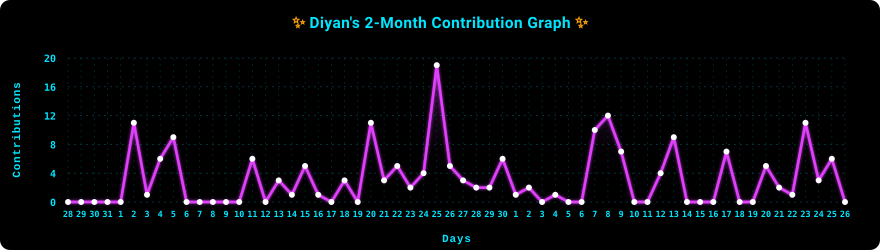

<!-- ================================================================= -->
<!--                DIYAN SHAH — GITHUB PROFILE PORTFOLIO              -->
<!-- ================================================================= -->

<div align="center">
  <a href="https://github.com/Diyan4444">
    
  </a>
</div>

<br>

<div align="center">

[](https://github.com/Diyan4444)

<br>

[](https://github.com/Diyan4444)
[](https://www.linkedin.com/in/diyan-shah-14b4993a9/)
[](https://leetcode.com/u/diddy4/)
[](mailto:diyanshah2301@gmail.com)

</div>

---

## ⚡ About Me

I'm **Diyan Shah**, an **Information Technology Sophomore at VJTI Mumbai (Veermata Jijabai Technological Institute)**.

I believe in learning by shipping real software from first principles. Rather than stopping at surface tutorials, I focus on building resilient systems that solve real operational bottlenecks—from full-stack platforms and production Chrome extensions (Manifest V3) to SAR satellite oil spill tracking, media transcoding pipelines, and predictive industrial telemetry.

```text
  [ Education   ]   Information Technology Sophomore — VJTI Mumbai
  [ Core Focus  ]   Full-Stack Systems • Browser Tooling • Applied AI • Algorithmic Problem Solving
  [ Current DSA ]   C++ STL & Data Structures — LeetCode (@diddy4)
  [ Philosophy  ]   "Learn by shipping real software. Deep dives over surface tutorials."
```

---

## 🚀 Featured Projects

A curated selection of production applications and engineering tools I've designed and shipped:

### 1. 💇 [Glamourly](https://github.com/Diyan4444/Glamourly) — Mumbai Salon Discovery & Direct Booking
> **Links:** [`GitHub Repository`](https://github.com/Diyan4444/Glamourly) • [`Live Demo`](https://glamourly.vercel.app)  
* **Problem Solved:** Traditional booking aggregators force upfront payments, add hidden convenience markups, and lack local stylist transparency.
* **Architecture & Highlights:** Direct slot reservation engine with a 100% pay-at-salon offline model, verified Mumbai studio directory, instant email booking passes with Google Maps coordinates, customer appointment management portal, and an integrated AI concierge assistant.
* **Tech Stack:** `Next.js (App Router)` • `React` • `TypeScript` • `Tailwind CSS` • `MongoDB Atlas` • `Netlify`

---

### 2. ⚡ [Leet-Vault](https://github.com/Diyan4444/Leet-Vault) — Multi-Solution GitHub Sync Chrome Extension
> **Links:** [`GitHub Repository`](https://github.com/Diyan4444/Leet-Vault) • [`Live Dashboard`](https://leet-git-hub.vercel.app)  
* **Problem Solved:** Standard LeetCode extension sync tools overwrite prior submissions, preventing developers from saving multiple algorithmic approaches to the same problem.
* **Architecture & Highlights:** Production Manifest V3 extension enabling unlimited named solutions per problem (`0912-sort-an-array/heap-sort.cpp`, `merge-sort.cpp`), offline alarm queue for network resilience, GitHub OAuth broker, and 50+ unit tests across DOM observers.
* **Tech Stack:** `TypeScript` • `Chrome Extensions MV3` • `Vite` • `Vitest` • `Tailwind CSS` • `Vercel Serverless`

---

### 3. 🚗 [RentWheels](https://github.com/Diyan4444/RentWheels) — Multi-Category Vehicle Rental Marketplace
> **Links:** [`GitHub Repository`](https://github.com/Diyan4444/RentWheels) • [`Live Demo`](https://wheel-rent.netlify.app/)  
* **Problem Solved:** Vehicle rental platforms are typically fragmented across separate apps for two-wheelers, passenger cars, and commercial transport.
* **Architecture & Highlights:** Unified multi-tier rental catalog spanning scooters, superbikes, sedans, electric trucks, and passenger buses; dynamic client-side filtering, interactive reservation cart, booking confirmation modals, and responsive dark UI without framework bloat.
* **Tech Stack:** `JavaScript (ES6+)` • `HTML5` • `CSS3` • `Netlify`

---

### 4. 🛰️ [OceanGuard AI](https://github.com/Diyan4444/OceanGuard) — Satellite Oil Spill Attribution & Hindcasting
> **Links:** [`GitHub Repository`](https://github.com/Diyan4444/OceanGuard) • *Smart India Hackathon 2026 (Problem SIH26143)*  
* **Problem Solved:** Marine vessels illegally discharge bilge oil in open waters; ocean drift makes identifying the guilty vessel nearly impossible without automated spatial-temporal hindcasting.
* **Architecture & Highlights:** Computer vision segmentation of Synthetic Aperture Radar (SAR) imagery to isolate dark slicks, hydrodynamic backward drift simulation using wind and current vectors to pinpoint origin coordinates, and automated cross-referencing against global AIS ship tracks to compute suspect anomaly scores.
* **Tech Stack:** `Python` • `FastAPI` • `NumPy` • `SciPy` • `React 19` • `Vite` • `Leaflet` • `CartoDB Dark Tiles` • `SQLite`

---

### 5. 🎬 [yt-to-mp4](https://github.com/Diyan4444/yt-to-mp4) — Containerized Media Transcoder & Converter
> **Links:** [`GitHub Repository`](https://github.com/Diyan4444/yt-to-mp4)  
* **Problem Solved:** Online media converters are bloated with intrusive ads, redirect traps, and fail on high-bitrate media transcoding tasks.
* **Architecture & Highlights:** Clean, ad-free web service with dynamic container format and audio bitrate probing, concurrency throttling (`MAX_CONCURRENT_DOWNLOADS=5`) to prevent CPU starvation during FFmpeg jobs, real-time download progress streaming via API polling, and automated ephemeral scratch file cleanup.
* **Tech Stack:** `Python` • `Flask` • `yt-dlp` • `FFmpeg` • `Docker` • `Render Config`

---

### 6. 🛢️ [Well-Whisperer](https://github.com/Diyan4444/Well-Whisperer) — Predictive Well Telemetry & Oilfield Analytics
> **Links:** [`GitHub Repository`](https://github.com/Diyan4444/Well-Whisperer) • *Smart India Hackathon 2026 (PS 121 — Oil India Limited)*  
* **Problem Solved:** Undetected drill-string anomalies and pressure spikes cause catastrophic downhole equipment failures and non-productive drilling time.
* **Architecture & Highlights:** Real-time wellbore telemetry monitoring dashboard, automated sensor anomaly detection, predictive maintenance alerting thresholds, and comparative performance benchmarking against historical synthetic field datasets.
* **Tech Stack:** `React 19` • `TypeScript` • `FastAPI (Python 3.12)` • `Supabase (PostgreSQL)` • `Vite`

---

## 💻 Skills & Technologies

<table>
  <tr>
    <td width="25%" valign="top">
      <h4>⚡ Languages</h4>
      <ul>
        <li><b>TypeScript</b></li>
        <li><b>JavaScript [ES6+]</b></li>
        <li><b>C++ [STL / DSA]</b></li>
        <li><b>Python 3</b></li>
        <li><b>SQL / PostgreSQL</b></li>
        <li><b>HTML5 &amp; CSS3</b></li>
      </ul>
    </td>
    <td width="25%" valign="top">
      <h4>🌐 Frontend &amp; UI</h4>
      <ul>
        <li><b>Next.js (App Router)</b></li>
        <li><b>React &amp; React 19</b></li>
        <li><b>Tailwind CSS</b></li>
        <li><b>Vite &amp; Bundlers</b></li>
        <li><b>Leaflet.js Maps</b></li>
      </ul>
    </td>
    <td width="25%" valign="top">
      <h4>⚙️ Backend &amp; Systems</h4>
      <ul>
        <li><b>Node.js &amp; Express</b></li>
        <li><b>FastAPI (Python)</b></li>
        <li><b>Flask REST APIs</b></li>
        <li><b>Chrome Extensions (MV3)</b></li>
        <li><b>FFmpeg &amp; Transcoding</b></li>
      </ul>
    </td>
    <td width="25%" valign="top">
      <h4>🗄️ Database &amp; DevOps</h4>
      <ul>
        <li><b>MongoDB Atlas</b></li>
        <li><b>Supabase &amp; Postgres</b></li>
        <li><b>Redis &amp; SQLite</b></li>
        <li><b>Docker &amp; Containers</b></li>
        <li><b>Git &amp; GitHub Actions</b></li>
      </ul>
    </td>
  </tr>
</table>

---

## 📊 GitHub Stats & Activity

<div align="center">
  
</div>

<br>

<div align="center">
  
  &nbsp;
  
</div>

<br>

<div align="center">
  
</div>

<br>

---

## 📈 2-Month Contribution Graph

<div align="center">
  
</div>

---

## 📬 Get in Touch

<div align="center">

[](mailto:diyanshah2301@gmail.com)
&nbsp;&nbsp;
[](https://www.linkedin.com/in/diyan-shah-14b4993a9/)
&nbsp;&nbsp;
[](https://github.com/Diyan4444)
&nbsp;&nbsp;
[](https://leetcode.com/u/diddy4/)

</div>
