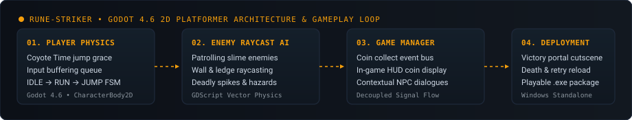

<!-- ================================================================= -->
<!--                       DIYAN SHAH — PROFILE                        -->
<!-- ================================================================= -->

  

 

&nbsp;

&nbsp;

&nbsp;

&nbsp;

 
## Who I Am

I’m **Diyan Shah**, an Information Technology sophomore at **VJTI Mumbai**.

I enjoy building full-stack web applications, browser tools, and hackathon prototypes, alongside practicing data structures and algorithms in C++. I like software that solves one real, annoying problem well, and I learn best by shipping working systems from the ground up.

* **Currently:** Practicing C++ STL & algorithmic problem solving on LeetCode, and developing our Smart India Hackathon 2026 builds ([OceanGuard AI](https://github.com/Diyan4444/OceanGuard) and [Well-Whisperer](https://github.com/Diyan4444/Well-Whisperer)).
* **Open to:** Hackathon teams, open-source initiatives, and engineering collaborations.

---

### 🌐 Open-Source Development
* Exploring, discussing, and reviewing open-source developer tooling, systems libraries, and backend infrastructure. Learning in public across personal repositories, problem-solving archives and community issues.

---

## Toolkit

<table>
  <tr>
    <td width="25%" valign="top">
      <h4>⚡ Languages</h4>
      <ul>
        <li>TypeScript</li>
        <li>JavaScript (ES6+)</li>
        <li>C++ (STL / DSA)</li>
        <li>Python 3.12</li>
        <li>SQL (PostgreSQL)</li>
        <li>HTML5 &amp; CSS3</li>
      </ul>
    </td>
    <td width="25%" valign="top">
      <h4>🌐 Frontend</h4>
      <ul>
        <li>React &amp; React 19</li>
        <li>Next.js (App Router)</li>
        <li>Tailwind CSS</li>
        <li>Vite &amp; Vitest</li>
        <li>Leaflet &amp; Three.js</li>
      </ul>
    </td>
    <td width="25%" valign="top">
      <h4>⚙️ Backend &amp; Systems</h4>
      <ul>
        <li>FastAPI (Python)</li>
        <li>Flask REST APIs</li>
        <li>Chrome Extensions (MV3)</li>
        <li>Docker &amp; Gunicorn</li>
        <li>yt-dlp &amp; FFmpeg</li>
      </ul>
    </td>
    <td width="25%" valign="top">
      <h4>🗄️ Data &amp; Deploy</h4>
      <ul>
        <li>Supabase PostgreSQL</li>
        <li>MongoDB (Mongoose)</li>
        <li>SQLite (aiosqlite)</li>
        <li>Netlify &amp; Vercel</li>
        <li>GitHub Actions CI/CD</li>
      </ul>
    </td>
  </tr>
</table>

> *Built so far: an accepted-solution GitHub sync extension for LeetCode, a curated salon discovery & booking platform, a satellite oil-spill tracer, a nearby wells drilling intelligence system, a containerised media converter, and an accessible vehicle rental marketplace.*

---

## Projects

<table>
  <tr>
    <td width="50%" valign="top">
      <h3>1. <a href="https://github.com/Diyan4444/Glamourly">Glamourly</a></h3>
      
Curated salon discovery and direct offline appointment booking platform for Mumbai neighbourhoods.

      <ul>
        <li>100% pay-at-salon booking model with transparent rate cards and zero advance deposit.</li>
        <li>Browse verified listings with distance filtering, ratings, and Leaflet map directions.</li>
        <li>Provider dashboard for stylist rosters, schedules, and Shop Act verification.</li>
      </ul>
      
<strong>Stack:</strong> <code>Next.js</code> · <code>React</code> · <code>TypeScript</code> · <code>Tailwind CSS</code> · <code>MongoDB</code>

      
🔗 <a href="https://github.com/Diyan4444/Glamourly"><strong>Repository</strong></a> · <a href="https://glamourly.vercel.app"><strong>Live Demo</strong></a>

    </td>
    <td width="50%" valign="top">
      <h3>2. <a href="https://github.com/Diyan4444/Rune-Striker">Rune-Striker</a></h3>
      
Fast-paced retro 2D platforming adventure focusing on responsive movement, timing, and precision.

      <ul>
        <li>Kinematic state machine with responsive jumping, coyote time, and directional turn animations.</li>
        <li>Autonomous slime patrol enemies, raycast ledge detection, and death/retry mechanics.</li>
        <li>Decoupled signal architecture with HUD tracking and standalone Windows release build.</li>
      </ul>
      
<strong>Stack:</strong> <code>Godot Engine</code> · <code>GDScript</code> · <code>Windows Executable</code>

      
🔗 <a href="https://github.com/Diyan4444/Rune-Striker"><strong>Repository</strong></a>

    </td>
  </tr>
  <tr>
    <td width="50%" valign="top">
      <h3>3. <a href="https://github.com/Diyan4444/RentWheels">Rent Wheels</a></h3>
      
Accessible multi-category vehicle rental browsing website bringing bikes, cars, and vans together.

      <ul>
        <li>Multi-tier vehicle browsing with daily rental price comparison and category filtering.</li>
        <li>Interactive reservation cart and confirmation modals built with zero heavy frameworks.</li>
        <li>Pure responsive web fundamentals deployed with instant edge delivery on Netlify.</li>
      </ul>
      
<strong>Stack:</strong> <code>HTML</code> · <code>CSS</code> · <code>JavaScript (No Framework)</code> · <code>Netlify</code>

      
🔗 <a href="https://github.com/Diyan4444/RentWheels"><strong>Repository</strong></a> · <a href="https://wheel-rent.netlify.app/"><strong>Live Website</strong></a>

    </td>
    <td width="50%" valign="top">
      <h3>4. <a href="https://github.com/Diyan4444/Shorties">Code Crumbs</a></h3>
      
Lightweight collection of C++ console programs, modular utilities, and logic drills.

      <ul>
        <li>Direct implementation of student records, grading algorithms, and console data processing.</li>
        <li>Clean source code organization paired with pre-compiled <code>.exe</code> binaries for rapid execution.</li>
        <li>Practical drills exploring C++ standard library structures, memory layout, and system interaction.</li>
      </ul>
      
<strong>Stack:</strong> <code>C++</code> · <code>STL</code> · <code>Windows CLI</code>

      
🔗 <a href="https://github.com/Diyan4444/Shorties"><strong>Repository</strong></a>

    </td>
  </tr>
  <tr>
    <td width="50%" valign="top">
      <h3>5. <a href="https://github.com/Diyan4444/Leet-Vault">LeetVault</a></h3>
      
Automated Chrome extension for syncing accepted LeetCode solutions directly to your GitHub repository.

      <ul>
        <li>Keeps unlimited named solutions per problem without overwriting previous algorithms.</li>
        <li>Triggers strictly on submission clicks with deterministic fallback numbering.</li>
        <li>Uses Chrome Identity OAuth and GitHub REST API (no LeetCode GraphQL).</li>
      </ul>
      
<strong>Stack:</strong> <code>TypeScript</code> · <code>Manifest V3</code> · <code>Vite</code> · <code>Vitest</code>

      
🔗 <a href="https://github.com/Diyan4444/Leet-Vault"><strong>Repository</strong></a>

    </td>
    <td width="50%" valign="top">
      <h3>6. <a href="https://github.com/Diyan4444/yt-to-mp4">YouTube-to-MP4</a></h3>
      
Containerised web application for downloading YouTube videos as MP4 or extracting audio as MP3.

      <ul>
        <li>Dynamic resolution and bitrate picker with real-time transfer progress and ETA streaming.</li>
        <li>Worker concurrency limiting to safeguard system memory during heavy FFmpeg jobs.</li>
        <li>Production Docker container deployment with multi-worker Gunicorn server.</li>
      </ul>
      
<strong>Stack:</strong> <code>Python</code> · <code>Flask</code> · <code>yt-dlp</code> · <code>FFmpeg</code> · <code>Vanilla JavaScript</code> · <code>Docker</code> · <code>Gunicorn</code>

      
🔗 <a href="https://github.com/Diyan4444/yt-to-mp4"><strong>Repository</strong></a>

    </td>
  </tr>
</table>

 

### More Exploring

#### 🏛️ SIH Development
* **[OceanGuard AI](https://github.com/Diyan4444/OceanGuard)** — AI satellite radar imagery analysis platform detecting marine oil spills, hindcasting drift paths, and attributing suspect ships via AIS data *(Smart India Hackathon 2026 • Problem SIH26143)*.
* **[Well-Whisperer](https://github.com/Diyan4444/Well-Whisperer)** — Real-time Nearby Wells Intelligence System (NWIS) and eRTMAC drilling advisory platform analyzing historical offset well logs before the bit drills *(Smart India Hackathon 2026 • PS 121 — Oil India Limited)*.

<!-- Template for future contributions:
* **[Project Name](link)** — Brief description of merged PR or enhancement.
-->

<b>🔍 See how these are built (Architecture Flows)</b>

 

  
    
  
    
  
    
  
    
  
    
  
    
  

---

## Live Numbers & Activity

  

 

  

 

  

---

  

<h4 align="center">I’m always glad to connect with fellow developers, students, and collaborators.</h4>

&nbsp;&nbsp;

&nbsp;&nbsp;

 

  Also on: <a href="https://leetcode.com/u/diddy4/">LeetCode (@diddy4)</a> • <a href="https://codeforces.com/profile/diyanshah2301">Codeforces (@diyanshah2301)</a>
    

<h3 align="center">Learn by shipping.</h3>
